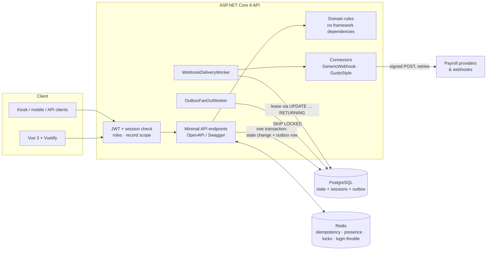

# TimeLedger

**Time & attendance engine with payroll integrations**, built on ASP.NET Core 8, EF Core 8, PostgreSQL, Redis and Vue 3.

TimeLedger turns raw clock-in/clock-out punches into payroll-ready timesheets under Indonesian labour rules (PP 35/2021), manages leave and balances behind role-based sign-in, and pushes the results to payroll providers and webhooks through a transactional outbox with signed, retried, dead-lettered deliveries.

---

## What it does

| Area | Highlights |
| --- | --- |
| **Access control** | Email + password sign-in, revocable sessions, three roles (employee, supervisor, payroll admin) and per-record scoping: team-only supervisors, hidden team pay, no self-approval. |
| **Clocking** | `POST /api/clock-events` with a required `Idempotency-Key` (Redis `SET NX` + a unique DB index as backstop). Sequence rules hold under concurrent requests: no double clock-in, no orphan clock-out, no backdating, nothing into a closed period. |
| **Presence** | "Who's in now" served from a Redis snapshot, invalidated on every punch, rebuilt from PostgreSQL, filtered to what the caller may see. |
| **Timesheets** | Pairs punches into shifts, assigns each shift to the **local day it started** (night shifts aren't split), and classifies days as workday / rest day / public holiday per the employee's 5- or 6-day schedule. |
| **Overtime** | PP 35/2021 multipliers and the 1/173 hourly rate, per minute, rounded to whole rupiah. Daily (4h) and weekly (18h) limit breaches on workdays are flagged, not blocked, because the hours were worked and must be paid. |
| **Anomalies** | Missing clock-out, orphan clock-out, shifts over 16h, absence without leave, work on a leave day. Surfaced for review; never silently "fixed". |
| **Leave** | Requests counted in working days (skipping rest days and holidays), overlap checks, annual balance (12-day statutory minimum), approval with optimistic concurrency. |
| **Pay periods** | Live preview while open; **close** freezes timesheet lines and publishes `payroll.period_closed` in the same transaction. A Redis lock stops two operators closing at once; PostgreSQL `xmin` is the backstop. |
| **Integrations** | Pluggable connectors: a signed generic webhook and a Gusto-style payroll mapping. Outbox fan-out → per-connection delivery rows → HMAC-SHA256 signed POST → exponential backoff with jitter → dead letter → operator retry. |
| **Frontend** | Vue 3 Composition API + TypeScript + Vuetify 3: presence board, timesheet review with per-day drill-down, leave approvals, delivery log. |

## Architecture



```
src/TimeLedger.Domain     Entities and pure business rules. No EF, no ASP.NET: unit-testable in isolation.
src/TimeLedger.Api        Minimal APIs, auth, EF Core mapping and migrations, Redis services, connectors, background workers.
tests/TimeLedger.Tests    xUnit: domain rules, plus API integration tests on real PostgreSQL and Redis.
web/                      Vue 3 + TypeScript + Vuetify 3 (Vite).
```

## Authentication and authorization

Every endpoint requires a signed-in user except `POST /api/auth/login`, `GET /health` and, where the mock provider is enabled, its HMAC-verified webhook receiver. A fallback policy also closes any endpoint that forgets to declare one.

### Roles

| | Employee | Supervisor | Payroll admin |
| --- | :---: | :---: | :---: |
| See profiles, presence, punches, leave and timesheets | Self | Self + direct reports | Everyone |
| See salary and overtime pay | Self | Self | Everyone |
| Clock in and out | Self | Self | Everyone |
| Set the time of a punch (corrections) | – | – | Others, not self |
| Request leave | Self | Self | Everyone |
| Approve or reject leave | – | Direct reports | Others, not self |
| List pay periods and holidays | Yes | Yes | Yes |
| Create employees, assign supervisors | – | – | Yes |
| Open and close pay periods, edit holidays | – | – | Yes |
| Integrations and delivery log | – | – | Yes |
| Manage accounts | – | – | Others, not self |

- **A team is direct reports**, set with `PUT /api/employees/{id}/supervisor`. Reporting loops are rejected.
- **Team overtime pay is hidden from supervisors** along with salary, because salary can be derived from it. They still see hours and anomalies.
- **The approver is the signed-in user.** A `decidedBy` in the request body is ignored.
- **Status codes:** `401` means not signed in (or the session ended), `403` means not allowed, and `404` also covers records outside your scope, so ids can't be probed.

### Using it

```bash
TOKEN=$(curl -s localhost:5080/api/auth/login \
  -H 'Content-Type: application/json' \
  -d '{"email":"admin@timeledger.local","password":"TimeLedger-Demo-2026"}' | jq -r .accessToken)

curl -s localhost:5080/api/employees -H "Authorization: Bearer $TOKEN"
```

In Swagger, call the login endpoint, then paste the `accessToken` into **Authorize**.

Accounts are managed through the API by a payroll admin (there is no UI for this yet):

```bash
# role: Employee | Supervisor | PayrollAdmin. employeeId is optional only for PayrollAdmin.
curl -s localhost:5080/api/users -H "Authorization: Bearer $TOKEN" -H 'Content-Type: application/json' \
  -d '{"email":"new.person@company.com","password":"at-least-12-characters","role":"Employee","employeeId":"<id>"}'

# Any of role, isActive, newPassword. A change signs that user out everywhere.
curl -s -X PATCH localhost:5080/api/users/<user id> -H "Authorization: Bearer $TOKEN" -H 'Content-Type: application/json' \
  -d '{"isActive":false}'
```

### How it works

- **Tokens identify a session and nothing else.** The HS256 JWT carries a user id and a session id. Role, team and active status come from PostgreSQL on every request, so logout, deactivation, role changes and team moves apply to the next request, at the cost of one indexed query.
- **Revocation:** logout ends one session. A password change or reset, a role change or a deactivation ends all of that user's sessions.
- **Passwords:** 12–128 characters, hashed with PBKDF2-HMAC-SHA512 at 210,000 iterations. Unknown, wrong and disabled accounts get the same response after the same hashing work.
- **Guessing:** 10 attempts per account per 5 minutes, then `429` with `Retry-After`. Because the limit is per account, someone who knows an email can lock it for that window. Add per-IP limits at your proxy.
- **The browser** keeps the token in `sessionStorage` (one sign-in per tab, gone when it closes), behind a Content Security Policy that allows only same-origin scripts. The UI hides what a role can't do, and the API is what enforces it.

### Configuration

Use environment variables (`Auth__SigningKey`) or any other .NET configuration source.

| Setting | Default | Notes |
| --- | --- | --- |
| `Auth:SigningKey` | none | **Required outside Development**, at least 32 bytes (`openssl rand -base64 48`). All replicas must share it. In Development an empty value means a random key per start. |
| `Auth:SessionMinutes` | `480` | Session and token lifetime. There are no refresh tokens. |
| `Auth:MaxFailedLogins` | `10` | Attempts per account per window. |
| `Auth:LockoutMinutes` | `5` | Length of the window. |
| `Auth:BootstrapAdmin:Email` / `:Password` | none | Creates the first payroll admin. Ignored while an active one exists, so remove it after first start. |
| `Auth:Issuer` / `Auth:Audience` | `timeledger` / `timeledger-api` | Validated on every token. |
| `Swagger:Enabled` | Development only | |

For a deployment:

1. Set `ASPNETCORE_ENVIRONMENT=Production`. This turns off seeding, demo accounts, Swagger and the mock provider.
2. Set `Auth__SigningKey` and the two `Auth__BootstrapAdmin__*` values.
3. Serve it over HTTPS. Bearer tokens and passwords must not cross a network in clear text.

## Design decisions

**Transactional outbox, not "save then call".** Closing a period writes the frozen lines, the status change and an `outbox_messages` row in one `SaveChanges`. If the commit fails, no event exists; if it succeeds, the event will be delivered even if the process dies a millisecond later. Calling the payroll provider inside the request would give you either lost exports or exports for rolled-back data.

**Two-stage delivery.** Stage 1 fans each event out into one `webhook_deliveries` row per subscribed connection, using `FOR UPDATE SKIP LOCKED` so several API instances can run the worker safely. Stage 2 claims due rows with `UPDATE … SET next_attempt_at = now() + lease … RETURNING *`, so HTTP calls happen **outside** any open transaction, and a crashed worker's rows come back when the lease expires. A batch is sent in parallel, so it finishes well inside the lease and one slow provider doesn't hold up the others. A paused connection keeps its pending deliveries until it is resumed; events published while it is paused are not queued for it.

**Retry what is transient, dead-letter what isn't.** Network errors, 408, 429 and 5xx back off exponentially (5 s base, 30 min cap, equal jitter, 8 attempts). Redirects (never followed) and other 4xx responses dead-letter immediately, because resending a request the provider called invalid only repeats the failure. Dead letters can be requeued from the UI after the cause is fixed.

**Receivers can trust and de-duplicate.** Every delivery carries `X-TimeLedger-Signature: t=<unix>,v1=<hmac>` over `"t.body"` (replay-resistant, constant-time verified) and `X-TimeLedger-Delivery: <id>` for receiver-side idempotency, since at-least-once delivery means duplicates are possible.

**Punches are facts; timesheets are derived.** Clock events are append-only. Timesheets are recomputed from them until the period closes, then frozen. Corrections belong in an adjustment flow (see roadmap), not in edits to history.

**Idempotency in two layers.** Redis answers duplicates fast and replays the original response. If it lost the key (eviction, restart), the punch is found in PostgreSQL and replayed the same way, with a unique index on `(employee_id, idempotency_key)` as the backstop. Keys are scoped to the employee, and reusing one for a different punch is a `422`.

**Advisory locks for rules that span rows.** "No overlapping leave", "punches alternate" and "nothing changes under a closing period" can't be protected by a row version. Writes about an employee take a shared ledger lock plus that employee's lock. Closing a period takes the ledger lock exclusively, so it waits for writes in flight and holds new ones until the freeze commits.

**A close never cuts a running shift.** A period can close once its last day is over in every active employee's time zone and nobody is still on a shift that started in it. A shift open for more than 16 hours is treated as a forgotten clock-out: flagged, and not a blocker.

**Optimistic concurrency via `xmin`.** Leave approvals, balances and pay periods use PostgreSQL's `xmin` system column as the EF Core row version, with no extra column to maintain. A lost race, such as a double approval, is a clean `409`.

**Time zones are explicit.** Instants are stored as UTC `timestamptz`; days are `date`; each employee has an IANA zone. "Which day does this shift belong to" is decided in the employee's local time, which is the bug most attendance systems get wrong first.

## Overtime rules implemented (PP 35/2021)

Hourly rate = monthly wage ÷ 173.

| Day | 5-day week | 6-day week |
| --- | --- | --- |
| Workday (normal day) | 8 h | 7 h |
| Workday overtime | 1st hour × 1.5, then × 2 | 1st hour × 1.5, then × 2 |
| Rest day / public holiday | hours 1–8 × 2, 9th × 3, 10th–12th × 4 | hours 1–7 × 2, 8th × 3, 9th–11th × 4 |
| Limits (flagged, workdays only: Pasal 26) | 4 h/day, 18 h/week | 4 h/day, 18 h/week |

Simplifications, stated so they're not mistaken for oversights: partial hours are paid pro rata per minute; the special shorter-day bands for a holiday on a 6-day week's shortest day are not modelled; breaks are assumed to be punched out. The tests in `OvertimeCalculatorTests` pin every band with hand-checkable numbers (salary 5,190,000 → 30,000/hour).

Known gaps that affect pay, to settle before real payroll use:

- **6-day week, 40-hour cap.** Pasal 21 sets 7 h/day *and* 40 h/week. Only the daily threshold is implemented, so six 7-hour days count as 42 regular hours, where 2 of them should be overtime. Fixing it needs a decision on which day is the short one.
- **Forgotten clock-outs are paid as worked.** The next clock-in is refused until the employee clocks out, and that late clock-out turns the whole gap into paid overtime (flagged as unusually long). Until there is an adjustment flow, a payroll admin should record the real clock-out time (`occurredAt`) before the employee clocks out.

Public holidays: the seeder adds fixed-date national holidays only. Moveable holidays (Idul Fitri, Nyepi, Waisak…) and *cuti bersama* are set yearly by joint ministerial decree; add them via `PUT /api/holidays/{date}`.

## Running it

### Docker (everything)

```bash
docker compose up --build
```

- UI: http://localhost:8080
- API + Swagger: http://localhost:5080/swagger

Sign in with a demo account. All use the password **`TimeLedger-Demo-2026`**:

| Email | Role | Sees |
| --- | --- | --- |
| `admin@timeledger.local` | Payroll admin | Everyone |
| `ayu@timeledger.local` | Supervisor | Ayu, Bima, Citra, Dimas |
| `eka@timeledger.local` | Supervisor | Eka, Fajar, Gita, Hendra |
| `bima@`, `citra@`, `dimas@`, `fajar@`, `gita@`, `hendra@timeledger.local` | Employee | Themselves |

These accounts are created only in the Development environment. The compose file runs in Development, so it publishes its ports on `127.0.0.1` only. To keep sign-ins across restarts, set `TIMELEDGER_SIGNING_KEY` before `docker compose up`.

The Development environment seeds eight employees, last month (closable) and this month (open), realistic punches with a few deliberate anomalies, leave requests, and two integrations pointed at a built-in **mock payroll provider** that verifies signatures and fails ~30% of requests with 503, so you can watch retries happen.

### Local development

```bash
docker compose up -d postgres redis

# API on http://localhost:5080
dotnet run --project src/TimeLedger.Api

# UI on http://localhost:5173 (proxies /api to the API)
cd web && npm install && npm run dev
```

### Tests

```bash
dotnet test                                                   # everything; needs Docker, takes about 3 minutes
dotnet test --filter "FullyQualifiedName!~Integration."       # no Docker, takes seconds
cd web && npm run typecheck
```

The integration tests start throwaway PostgreSQL and Redis containers with Testcontainers and leave your compose stack alone. They cover:

- **Every endpoint as every kind of caller.** A test fails if an endpoint is mapped without being added to that matrix.
- **Token attacks:** forged, expired, tampered, `alg: none`, wrong algorithm, issuer or audience, borrowed session.
- **Accounts:** login, lockout, revocation, password changes, admin races.
- **Record scope** for each role, including hidden pay.
- **Concurrency, webhook delivery and startup,** including the upgrade from a pre-auth database.

### Database migrations

Migrations run at startup, under a lock so that replicas can start together.

A database created by an earlier version (which used `EnsureCreated`) is detected, recorded as `InitialCreate` and upgraded in place with its data. In Development the demo accounts are then added for the seeded employees. Elsewhere, set the bootstrap admin to get your first sign-in. Back up first.

To change the schema:

```bash
dotnet tool install --global dotnet-ef --version 8.0.11
dotnet ef migrations add <Name> --project src/TimeLedger.Api -o Data/Migrations
```

## Try the end-to-end flow

Sign in as `admin@timeledger.local`, then:

1. **Timesheets** → pick last month → review anomalies (expand a row for the per-day breakdown).
2. **Close period & export** → timesheets freeze; `payroll.period_closed` is written to the outbox.
3. **Integrations** → watch two deliveries appear. Some fail with 503 and retry with backoff, then succeed.
4. `GET /mock/payroll-provider/received` (with the admin token) shows what the "provider" got: the Gusto-style payload on one connection, the canonical envelope on the other, all with valid signatures.
5. **Leave** → approve Bima's pending request, as admin or as their supervisor `ayu@timeledger.local` → a `leave.approved` delivery goes to the HR webhook only, because the payroll connection isn't subscribed to it.

`src/TimeLedger.Api/TimeLedger.Api.http` has the same flow as raw requests.

## API overview

| Method | Path | Who | Purpose |
| --- | --- | --- | --- |
| POST | `/api/auth/login` | Anyone | Get a token |
| GET | `/api/auth/me` | Signed in | Current account |
| POST | `/api/auth/logout` | Signed in | End this session |
| POST | `/api/auth/change-password` | Signed in | Change password, end all sessions |
| GET/POST | `/api/users` | Admin | List / create accounts |
| PATCH | `/api/users/{id}` | Admin | Role, status, password reset |
| GET | `/api/employees`, `/api/employees/{id}` | Signed in, scoped | Employees |
| POST | `/api/employees` | Admin | Create an employee |
| PUT | `/api/employees/{id}/supervisor` | Admin | Assign a supervisor |
| POST | `/api/clock-events` | Self, or admin | Clock in/out (requires `Idempotency-Key`) |
| GET | `/api/employees/{id}/clock-events` | Signed in, scoped | Punch history |
| GET | `/api/presence` | Signed in, scoped | Who's in now |
| GET | `/api/leave-requests` | Signed in, scoped | List leave |
| POST | `/api/leave-requests` | Self, or admin | Request leave |
| POST | `/api/leave-requests/{id}/approve` \| `/reject` | Supervisor of the employee, or admin | Decide leave |
| GET | `/api/employees/{id}/leave-balance` | Signed in, scoped | Annual balance |
| GET | `/api/holidays` | Signed in | Public holiday calendar |
| PUT | `/api/holidays/{date}` | Admin | Add or rename a holiday |
| GET | `/api/pay-periods` | Signed in | List periods |
| POST | `/api/pay-periods` | Admin | Open a period |
| GET | `/api/pay-periods/{id}/timesheets` | Signed in, scoped | Live preview or frozen lines |
| POST | `/api/pay-periods/{id}/close` | Admin | Freeze + publish `payroll.period_closed` |
| GET/POST | `/api/integrations` | Admin | Connections (secret shown once) |
| POST | `/api/integrations/{id}/enabled` | Admin | Pause / resume |
| GET | `/api/deliveries` | Admin | Delivery log |
| POST | `/api/deliveries/{id}/retry` | Admin | Requeue a dead letter |

Full OpenAPI spec at `/swagger/v1/swagger.json` (Development).

## Out of scope (on purpose) and roadmap

- **External identity (OIDC/SSO), MFA, self-service password reset and refresh tokens.** Sign-in is local email + password.
- **Kiosk and service credentials.** Every caller is a user account today, so a shared kiosk would need a payroll-admin token, which is too much power for a device.
- **An account-management screen.** The API is there.
- **Audit trail** of who recorded a punch or changed an account, and **timesheet adjustments** instead of edits to punches.
- **Webhook egress restrictions.** A payroll admin can point an integration at any URL the API can reach, including internal ones, and read the start of an error response in the delivery log. Restrict outbound traffic in production.
- **Real provider APIs.** The Gusto-style connector mirrors the shape of an employee-compensation payload; a production connector also needs OAuth, employee ID mapping and the provider's payroll-update endpoint.
- **Multi-tenancy and tenant isolation**, per-company overtime policies, BPJS/PPh 21 calculation hand-off.
